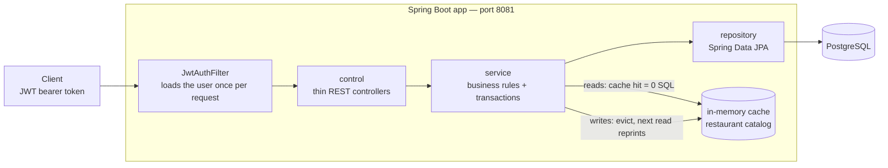
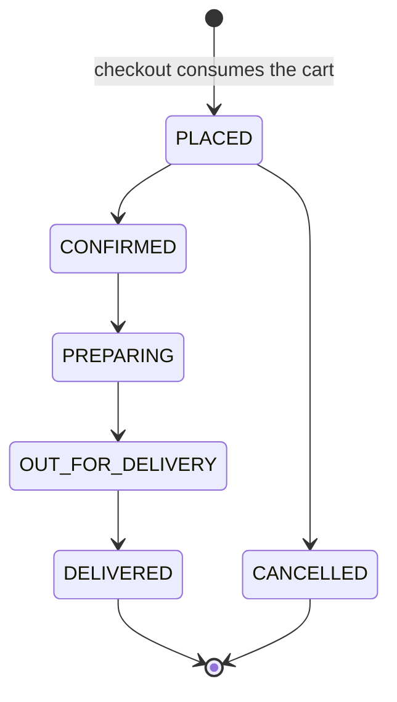

# Food Delivery App — a performance-hardened modular monolith

A production-style food-delivery backend built with **Spring Boot 4.1.1** and **Java 17**: authentication with roles, restaurant and menu management, a one-restaurant-per-order cart, an order state machine, and an admin panel — deliberately built as a **modular monolith**, then hardened with a full performance-engineering pass where every optimization was **measured, predicted, and verified** before being accepted.

- 34 REST endpoints, role-based access (CUSTOMER, RESTAURANT_OWNER, ADMIN)
- 48 automated tests (unit + integration) guarding the business rules
- Load-tested with k6; every data read runs at **constant SQL cost** regardless of data size
- Every fix is documented with before/after numbers in [docs/phase2/baseline.md](docs/phase2/baseline.md)

## Features

- **Authentication & security** — JWT login, BCrypt passwords, stateless filter chain, principal-based user lookup (one DB lookup per request, not three)
- **Restaurants & menu** — owners create and manage restaurants and menu items; customers browse the open catalog (cached with write-through eviction)
- **Cart** — one-restaurant-per-order rule, quantity limits, add / update / remove / clear, protected against lost updates with optimistic locking
- **Orders** — checkout consumes the cart, explicit state machine (PLACED → CONFIRMED → PREPARING → OUT_FOR_DELIVERY → DELIVERED, with CANCELLED), order history **paginated**
- **Admin** — user management with status control (blocking a owner automatically closes their open restaurants), platform-wide order and restaurant views (paginated)

## Tech stack

- Java 17, Spring Boot 4.1.1 (Web MVC, Data JPA, Security, Validation, Actuator, Cache)
- PostgreSQL (dev), H2 (in-memory, for the test suite)
- Spring cache abstraction (`@Cacheable` / `@CacheEvict`, in-memory ConcurrentMap backend)
- JJWT for token issuing and validation
- k6 for journey-based load testing; PowerShell seeding script
- Maven Wrapper — no local Maven install needed

## Getting started

**Prerequisites:** Java 17, a local PostgreSQL server, and (optionally) [k6](https://k6.io) for the load tests.

1. Create a database named `food_delivery` on your PostgreSQL instance.
2. Copy `src/main/resources/application-dev.yaml.example` to `application-dev.yaml` and fill in your local database credentials, JWT secret, and admin credentials. (This file is gitignored on purpose — real secrets never get committed.)
3. Start the app:

```
.\mvnw.cmd spring-boot:run
```

The app runs the `dev` profile on **port 8081**. Hibernate creates the schema on boot.

4. Seed demo data (a restaurant owner with two restaurants and menus, test customers, and a cart):

```
.\performance-tests\seed.ps1
```

## Load testing

The `performance-tests/` folder contains k6 scripts that model real user journeys, not single-endpoint pings:

- `restaurants.js` / `restaurants-ramp.js` — the read journey, and a ramp that finds where the system bends
- `auth-reads.js` — logged-in reads: cart, profile, order history (20 VUs × 60s in the measured runs)
- `checkout-journey.js` — the write journey: checkout, order history, cart refill
- `cart-race.js` — a deterministic lost-update race (two VUs patching the same cart row simultaneously)

```
k6 run --vus 20 --duration 60s .\performance-tests\checkout-journey.js
```

All scripts are idempotent: they log in first and reuse stable test identities, so they can be re-run any number of times.

## The performance story (the part I am most proud of)

The system was measured first, optimized second. The full evidence — methodology, SQL forensics, and every before/after number — lives in [docs/phase2/baseline.md](docs/phase2/baseline.md). At a glance, SQL statements per request before vs after:

| Endpoint                          | Before                        | After          |
| --------------------------------- | ----------------------------- | -------------- |
| GET /cart                         | 7 SQL, grows with cart size   | 2 SQL, constant |
| POST /cart/items (add to cart)    | ~12 SQL                       | 4 SQL, constant |
| POST /orders (checkout)           | 16 SQL                        | 9 SQL, constant |
| GET /orders (customer history)    | N + 5 SQL, unbounded payload  | 4 SQL per page |
| GET /orders/restaurant/mine (owner) | 1 + N SQL (4,996 rows once) | 4 SQL per page |
| GET /admin/orders                 | ~28 SQL + N rows              | 3 SQL per page |

The stories behind the table:

- **N+1 queries eliminated everywhere** — every number above was counted from real Hibernate logs, not estimated.
- **One DB lookup per request.** A wristband-style principal (`AuthUserDetails`) carries the loaded user from the security filter into services — the "who are you?" question went from three DB calls per request to one.
- **The catalog is cached.** The restaurant list is served from the cache (0 SQL on hits); every write path evicts, verified live: write → wipe → next read reprints.
- **The curve went flat.** Final load run at **4.5× the baseline data scale**: p95 **57.84 ms** vs the 54.68 ms baseline — essentially unchanged — where the pre-fix system's p95 exploded from 292 ms to 708 ms over similar data growth. Latency curves, not milliseconds, are the metric that matters.

Each fix followed the same loop: **count the SQL → predict the after → make the smallest change → count again.** Nine fixes, nine verified predictions, zero mystery left in the data access layer.

## Correctness under concurrency

The cart's read-modify-write flow had a classic lost-update race (two simultaneous writes, one silently vanishing). It now uses JPA **optimistic locking** (`@Version`): the row carries a version, stale writes fail instead of corrupting, and the failure is translated to a clean **409 CONFLICT**. The race is demonstrated deterministically by `cart-race.js`: 40 simultaneous writes produced 30 successes and 10 caught conflicts — zero silent data loss. (A practical lesson came with it: catch Spring's translated `OptimisticLockingFailureException`, never the Hibernate-internal type.)

## Testing

```
.\mvnw.cmd test
```

48 tests, all green: unit tests per service (Mockito, strict stubbing), a full-context test, and nine integration tests that drive real HTTP flows through the security filter chain against an in-memory database — including error oracles (wrong-role access, invalid state transitions, cross-user ownership).

## API overview

Base path: `/api/v1` — Bearer-token auth unless noted.

| Area                  | Who                | Endpoints                                                              |
| --------------------- | ------------------ | ---------------------------------------------------------------------- |
| Auth                  | public             | register (customer / owner / admin), login                              |
| Restaurants           | public             | list, get by id, menu per restaurant                                    |
| Restaurants           | owner              | create, update, status, delete, my-restaurants                          |
| Menu                  | owner / admin      | create, update, availability toggle, delete                             |
| Cart                  | customer           | get, add item, update quantity, remove item, clear                      |
| Orders                | customer           | place, history (paginated), get by id, cancel                           |
| Orders                | owner              | my restaurant's orders (paginated), status transitions                  |
| User                  | customer / owner   | profile get / update / delete (soft delete)                             |
| Admin                 | admin              | users (status control), orders (paginated), restaurants                 |

The complete inventory — every endpoint with method, role, and test status — is in [docs/phase2/baseline.md](docs/phase2/baseline.md).

## Architecture

A single Spring Boot process organized into clean inner modules: `control` (thin REST controllers), `service` (business rules and transactions), `repository` (Spring Data JPA), `entity` (JPA), `security` (JWT filter, principal, user details), and `dto` (request/response records — the only thing that crosses module boundaries). Business invariants live in services (the one-restaurant cart rule, the order state machine, quantity limits) and are guarded by tests. This structure is what makes the planned microservices extraction a deliberate, low-risk step rather than a rewrite.



The request path is one straight line: the stateless JWT filter authenticates the caller and carries the loaded user as the security principal, controllers only translate HTTP to method calls, services hold every business rule, and repositories talk to the database. The cache sits beside the service layer — reads hit it, every write evicts it.

### Order state machine

Orders move through an explicit, enforced lifecycle — illegal jumps are rejected with a 409:



## Roadmap

- **Phase 3 — microservices extraction** (planned, evidence-gated): split into user, restaurant, and order services behind an API gateway, each with its own schema; inter-service REST calls; an order-placed event through RabbitMQ (with an outbox for reliability); Docker Compose for one-command startup; distributed tracing. The extraction triggers are documented in the phase-2 doc: divergent load profiles, a second team, or a part needing a different datastore.
- Smaller items: index tuning and query plans as data grows, response-level ETags on catalog reads.
